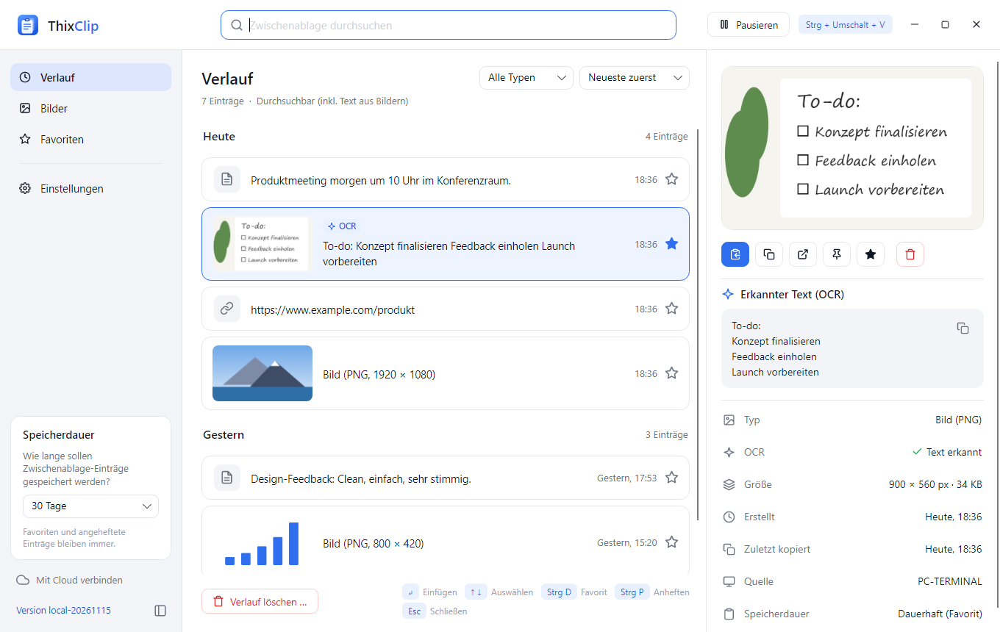
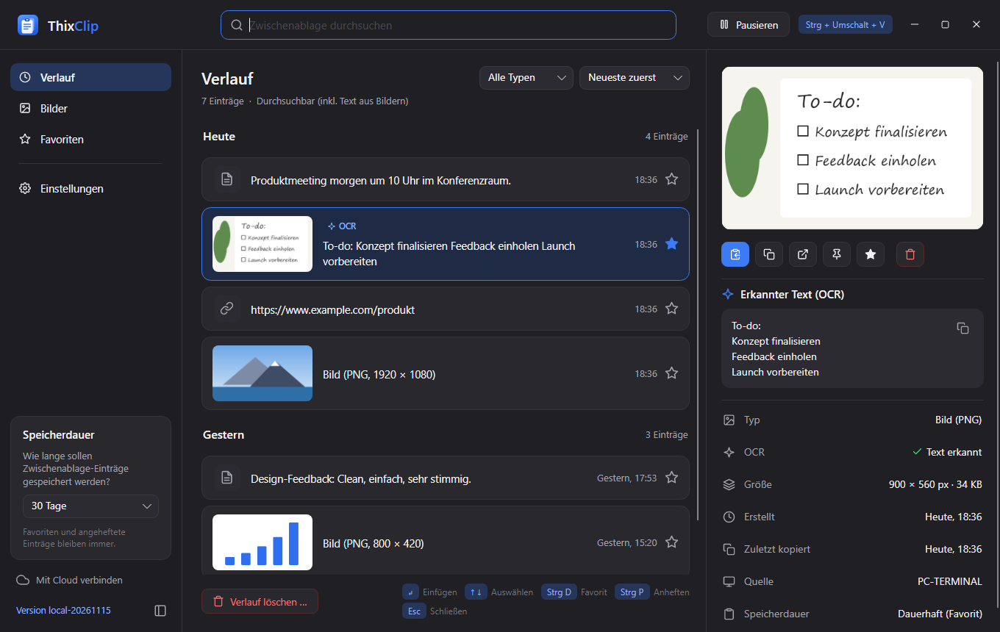
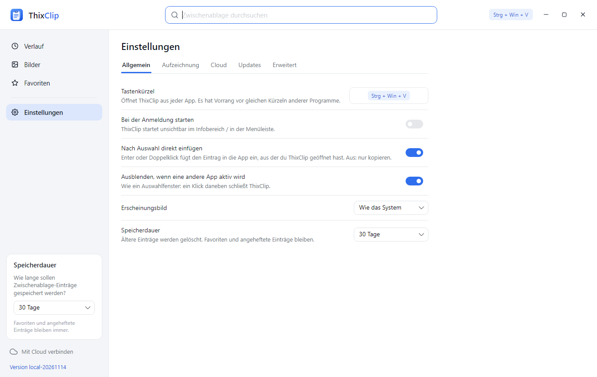
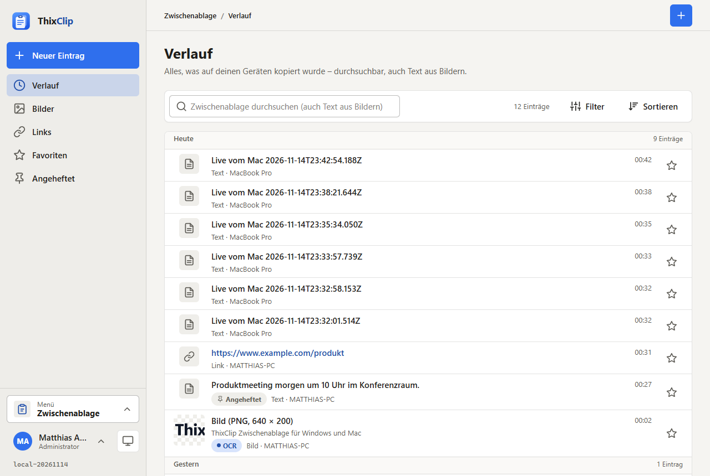
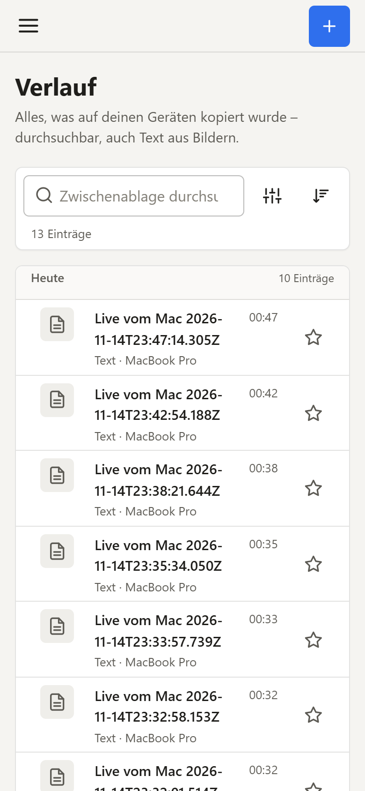
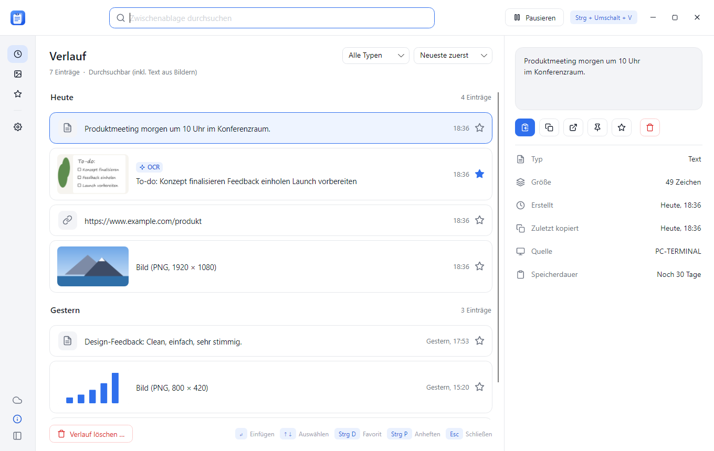
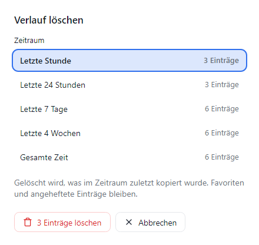
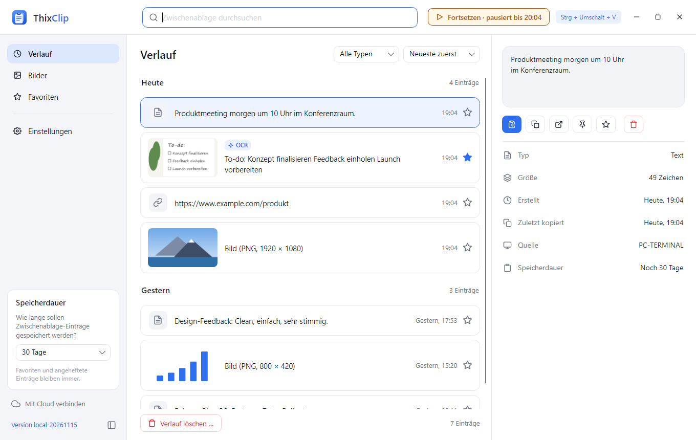
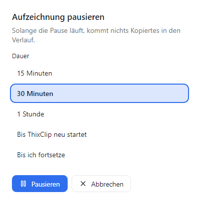
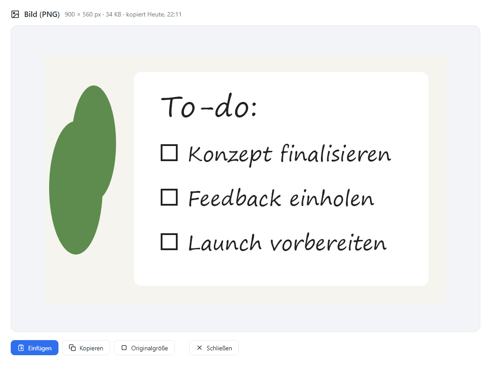

<p align="center"></p>

# ThixClip

**Der Zwischenablage-Verlauf für Windows und macOS** – schnell, komplett per Tastatur bedienbar und auf Wunsch über
**ThixClip.Cloud** auf allen deinen Computern gleich (auch im Browser).

- **Tastenkürzel**: `Strg + Umschalt + V` (Windows) bzw. `⌃⌥V` (macOS) öffnet ThixClip aus jeder App – es hat Vorrang vor
  gleichen Kürzeln anderer Programme und ist in den Einstellungen änderbar.
- **Sofort da**: das Fenster wird beim Start einmal gebaut und danach nur noch ein- und ausgeblendet; die Suche läuft
  im Speicher bei jedem Tastendruck.
- **Texte, Links und Bilder** – mit **Texterkennung (OCR)**: die Suche findet auch Text in Screenshots
  (Windows-OCR bzw. Apple Vision, offline auf dem Gerät).
- **Favoriten und Anheften**: bleiben dauerhaft, alles andere nach der **Speicherdauer** (1 Tag … unbegrenzt).
- **Verlauf löschen wie im Browser**: letzte Stunde, 24 Stunden, 7 Tage, 4 Wochen oder alles – mit der Anzahl je
  Zeitraum vorab; Favoriten und Angeheftetes bleiben, mit der Cloud verschwindet es auf allen Geräten.
- **Einklappbares Menü**: die Seitenleiste lässt sich auf ihre Symbole einklappen und bleibt so.
- **Aufzeichnung pausieren**: der Knopf oben im Fenster (oder `Strg/⌘ + Umschalt + P`, das Tray-Menü) fragt nach der Dauer –
  15 / 30 Minuten, 1 Stunde, bis zum Neustart oder bis du fortsetzt. Während der Pause trägt das Tray-Symbol ein
  Pause-Zeichen und oben steht „Fortsetzen“.
- **Ansehen**: ein Eintrag öffnet sich in ThixClip selbst – ein Bild groß (Leertaste: Originalgröße), ein Text oder Link
  ganz und markierbar; von dort einfügen, kopieren oder einen Link im Browser öffnen. Mit `Strg/⌘ + O`, `Strg/⌘`+Klick,
  einem Klick auf das Bild oder dem Knopf in der Vorschau.
- **Abstürze und Hänger werden sichtbar**: ein unerwarteter Fehler erscheint sofort mit seiner Meldung, ein Hänger wird mit
  Bericht (unter Windows mit Speicherabbild) im Protokollordner festgehalten; beim nächsten Start zeigt ThixClip den Bericht.
- **Vertrauliches bleibt draußen**: was Passwort-Manager als vertraulich markieren, wird nie aufgezeichnet.
- **Tray / Menüleiste**, **Autostart**, **Setup** (Windows) bzw. **App-Bundle + DMG** (macOS), **OTA-Updates** mit
  optionalem **Full-Auto-Update**.
- **ThixClip.Cloud** (Docker, Port 4950): Einträge, Favoriten und Löschungen werden zwischen allen Geräten abgeglichen,
  im Browser (PWA) liest, sucht, kopiert und ergänzt man den Verlauf auch unterwegs.

| Verlauf (hell) | Verlauf (dunkel) |
|---|---|
|  |  |

| Einstellungen | Cloud im Browser | Cloud auf dem Telefon |
|---|---|---|
|  |  |  |

## Bedienung per Tastatur

| Taste | Wirkung |
|---|---|
| `Strg + Umschalt + V` / `⌃⌥V` | ThixClip öffnen / schließen (global, einstellbar) |
| tippen | suchen (Text, Links, erkannter Text in Bildern) |
| `↑` `↓` `Bild↑` `Bild↓`, `Strg/⌘ + Pos1/Ende` | Eintrag wählen |
| `Enter` / Doppelklick | in die vorherige App **einfügen** (oder nur kopieren, siehe Einstellungen) |
| `Alt + 1` … `Alt + 9` | den n-ten Eintrag sofort einfügen |
| `Strg/⌘ + C` | kopieren und ThixClip schließen (abschaltbar: Einstellungen › „Nach dem Kopieren schließen“) |
| `Strg/⌘ + D` | Favorit |
| `Strg/⌘ + P` | anheften |
| `Entf` (Suche leer), `Strg + Entf` / `⌘ + ⌫` | löschen – der nächste Eintrag rückt nach und ist gewählt |
| `Strg/⌘ + O`, `Strg/⌘` + Klick | ansehen (Bild, Text, Link) – dort `Enter` einfügen, `Strg/⌘ + C` kopieren, `Leertaste` Originalgröße, `Esc` schließen |
| `Strg + Umschalt + Entf` / `⌘ + ⇧ + ⌫` | **Verlauf löschen**: Zeitraum mit `↑` `↓` wählen, `Enter` löscht, `Esc` bricht ab |
| `Strg/⌘ + F` | Suche |
| `Strg/⌘ + 1 / 2 / 3` | Verlauf / Bilder / Favoriten |
| `Strg/⌘ + ,` | Einstellungen |
| `Strg/⌘ + B` | Menü ein- / ausklappen |
| `Strg/⌘ + Umschalt + P` | Aufzeichnung pausieren (mit Dauer) / fortsetzen |
| `Esc` | Suche leeren, dann schließen (der Fokus geht zurück in die vorherige App) |

Die Versionsnummer unten links öffnet „Über ThixClip“ (eingeklappt: das ⓘ-Symbol), der Knopf daneben klappt das Menü ein.
Liegt ein Update bereit, steht es an der Versionsnummer; „Über ThixClip“ führt mit „Update installieren …“ zu Einstellungen › Updates.

| Menü eingeklappt | Verlauf löschen |
|---|---|
|  |  |

| Aufzeichnung pausiert | Pause mit Dauer | Bild ansehen |
|---|---|---|
|  |  |  |

## Installation

**Windows** – `ThixClipSetup.exe` aus dem [Release-Kanal](https://github.com/Real-TTX/ThixClip/releases/tag/release-channel)
starten (rund 38 MB). Installiert pro Benutzer nach `%LocalAppData%\Programs\ThixClip` (ohne Administratorrechte), mit
Startmenü, „Installierte Apps“, optional Autostart, Desktop-Verknüpfung und automatischen Updates (vorausgewählt).
Deinstallieren über „Installierte Apps“.

**macOS** – `ThixClip-macOS-arm64.dmg` (Apple Silicon) bzw. `-x64.dmg` (Intel) öffnen und ThixClip in „Programme“ ziehen.
ThixClip lebt in der Menüleiste. Zum Einfügen in andere Apps fragt macOS einmal nach der Erlaubnis
„Bedienungshilfen“ (ohne sie wird nur kopiert). Die App ist (noch) ad hoc signiert: beim ersten Start Rechtsklick › Öffnen.

**Cloud** – auf einem Server mit Docker:

```bash
docker compose up -d
```

Dann `http://<server>:4950` öffnen: der Einrichtungsassistent legt den Administrator an. Für den Zugriff aus dem Internet
gehört ein Reverse-Proxy mit HTTPS davor. In ThixClip unter Einstellungen › Cloud Adresse, Benutzer und Passwort eingeben –
das Passwort wird nur für die Anmeldung verwendet, das Gerät bekommt ein eigenes Token (entziehbar unter Konto › Geräte).
Details: [docs/CLOUD.md](docs/CLOUD.md).

## Versionen, Kanäle, Updates

| Branch | Version | Desktop-Kanal | Docker-Image |
|---|---|---|---|
| `main` | `0.1.<build>-<datum>` (z. B. `0.1.42-20261115`) | `release-channel` + Release `v<version>` | `ghcr.io/real-ttx/thixclip:latest`, `:release`, `:<version>` |
| `dev` | `nightly-<build>-<datum>` | `nightly-channel` | `:nightly`, `:<version>` |
| sonst / lokal | `local-<datum>` | – (keine Updates) | – |

Jede installierte Version prüft beim Start und alle 6 Stunden ihren eigenen Kanal (abschaltbar); mit
„Updates automatisch installieren“ (Full-Auto-Update, bei neuen Installationen an) wird ohne Rückfrage aktualisiert und neu gestartet.
Compose-Dateien: `docker-compose.yml` (Release), `docker-compose.dev.yml` (Nightly + pgAdmin),
`docker-compose.local.yml` (aus dem Quellcode gebaut, + pgAdmin, Postgres auf 4952).

## Für Administratoren

Richtlinien (Wert 1): Windows `HKLM\SOFTWARE\Policies\ThixClip`, macOS Konfigurationsprofil `info.schmoldt.thixclip`.

| Richtlinie | Wirkung |
|---|---|
| `LockConfiguration` | Einstellungen nur lesbar |
| `DisableCloud` | keine Verbindung zu ThixClip.Cloud |
| `DisableUpdates` | keine Update-Prüfung, keine Installation |

## Entwicklung

```bash
dotnet build ThixClip.slnx
dotnet test tests/ThixClip.Tests
dotnet test tests/ThixClip.Cloud.Tests
./scripts/redeploy.ps1
```

- `dotnet test tests/ThixClip.Tests` – Business-Layer, Sync gegen eine Cloud im Speicher und die Oberfläche headless
  gerendert (Tastatur-Abläufe; mit `THIXCLIP_SCREENSHOTS=<ordner>` auch Screenshots aller Seiten hell/dunkel).
  Mit `THIXCLIP_CLOUD_URL`, `THIXCLIP_CLOUD_USER`, `THIXCLIP_CLOUD_PASSWORD` läuft zusätzlich der Ende-zu-Ende-Test
  zweier Geräte gegen eine echte Cloud (z. B. den lokalen Stack).
- `ThixClip.exe --self-test <bericht.txt>` prüft das veröffentlichte (getrimmte) Programm selbst – JSON, SQLite, Skia, OCR,
  Verknüpfungen, alle Fenster – in einem eigenen Temp-Ordner; die CI führt das bei jedem Windows-Build aus.
- `THIXCLIP_DATA_DIR=<ordner>` startet die App mit eigenem Datenordner (eigene Instanz, berührt nichts Installiertes).
- Logo und Icons: `branding/` ([branding/README.md](branding/README.md)), neu rendern mit `cd tools && npm install && node render-icons.js`.
- Aufbau, Regeln und Protokoll: [CLAUDE.md](CLAUDE.md), [docs/CLOUD.md](docs/CLOUD.md).

© Matthias Schmoldt
